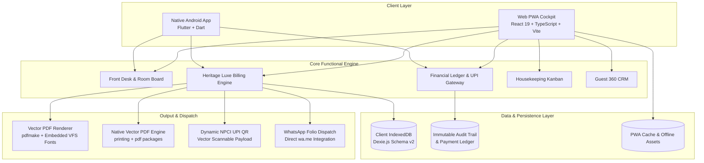

# 🏨 Ayushmaan OS — Enterprise Hotel Operating System & GST Billing Engine

> **A unified, offline-first Hotel Property Management System (PMS) and statutory GST Tax Invoice Engine designed specifically for independent luxury hotels, heritage resorts, and boutique hospitality properties.**

[](https://flutter.dev)
[](https://react.dev/)
[](https://www.typescriptlang.org/)
[](https://flutter.dev/)
[](#-heritage-luxe-v2-statutory-tax-invoicing)
[](#-offline-first-data-architecture)

---

## 🏛️ Executive Summary

Ayushmaan OS solves the two primary operational bottlenecks in independent hospitality management:
1. **Operational Friction**: Cluttered, slow ERP tables are replaced with a high-velocity, 3-click Front Desk Workspace and visual room lifecycle boards.
2. **Billing Fragility**: Replaces brittle, cloud-dependent billing with an offline-first, dual-engine vector invoice generator (Web `pdfmake` + Native Flutter `pdf`) producing museum-grade, statutory GST invoices (Heritage Luxe v2) with real dynamic NPCI UPI QR payment settlement.

The system is delivered as a **dual-platform ecosystem**:
- **Progressive Web App (PWA)**: Desktop, tablet, and browser-based property cockpit running on React 19 and Dexie IndexedDB.
- **Native Android Application**: Dedicated mobile APK built with Flutter, featuring on-device Bluetooth/Wi-Fi thermal printing, Android 13+ runtime permissions, and offline folio billing.

---

## 📐 System Architecture



---

## ✨ Core Modules & Functional Capabilities

### 1. 🏢 Front Desk & Visual Room Board
- **Color-Coded Status Matrix**: Instant visual distinction between *Occupied*, *Vacant (Ready)*, *Cleaning (with timer alerts)*, and *Maintenance*.
- **30-Second Fast Walk-in Check-in**: Streamlined check-in modal with automatic repeat-guest profile identification by phone number.
- **Reservation Folios**: Single-screen summary of guest details, room allocations, meal plans, stay dates, and tariff structures.

### 2. 📜 Heritage Luxe v2 Statutory Tax Invoicing
- **Statutory Compliance**: Full adherence to CBIC Rule 46 of the CGST Rules 2017 for tax invoices, credit notes, and supplementary folios.
- **Automatic SAC Resolution**: Dedicated GST slab assignment for accommodation (SAC 996311) based on per-night tariff thresholds, and food/beverage services (SAC 996331).
- **Dual Paper Geometry**:
  - **A4 Folio**: Enterprise letterhead format for corporate travelers, input tax credit claims, and audit records.
  - **A5 Compact**: Half-sheet slip format optimized for high-speed checkout and reduced paper consumption.
- **Editorial Luxury Typography**: Clean aesthetic incorporating ivory paper (`#FFFDF8`), imperial maroon (`#7A1F2B`), antique gold hairlines (`#B98A2F`), diamond ornament rules, and open 2-column party summaries without box containers.
- **Embedded Typography**: Embedded fonts ensure the Indian Rupee symbol (₹), Devanagari blessings, and serif wordmarks render identically across any phone, tablet, or printer without tofu boxes (`□□□`).

### 3. 💳 Financial Ledger & Dynamic UPI Gateway
- **Real Merchant UPI Payloads**: Vector QR codes encode standard NPCI payment payloads (`upi://pay?pa=...&am=...&tn=...`), allowing guests to scan and pay directly via BHIM, Google Pay, PhonePe, or Paytm.
- **Settlement Modes**: Multi-mode payment tracking supporting UPI, Cash, Credit/Debit Cards, and Split settlements.
- **Statutory Audit Log**: Immutable record of all transactions with real-time tracking of received amounts, pending balances, and round-offs.

### 4. 🧹 Housekeeping & Operations Kanban
- **Real-Time Task Progression**: Mobile-friendly 4-stage Kanban workflow (`Dirty` → `Cleaning` → `Inspection` → `Ready`).
- **Turnaround Timers**: Operational alerts for rooms exceeding standard turnover duration.
- **Cleaner Mobile Cockpit**: Dedicated mobile view for housekeeping staff without access to financial ledgers.

### 5. 👥 Guest 360° CRM & WhatsApp Dispatch
- **Guest Profiles**: Automatic aggregation of lifetime visit counts, total revenue, preferred room tiers, and special preferences.
- **Instant Digital Dispatch**: 1-click sharing of reservation vouchers and invoice summaries directly to guests' WhatsApp accounts.

---

## 📁 Repository & Directory Layout

```
Ayushmaan-Hotel-CRM/
├── dist-apk/                              # Compiled Android APK deliverables
│   └── Ayushmaan_Hotel_Flutter.apk        # Production-ready Flutter debug APK (180.9 MB)
├── flutter_app/                           # Native Flutter Android Application
│   ├── android/                           # Native Android Gradle configuration & manifests
│   ├── lib/
│   │   ├── models/                        # Dart domain models (Hotel, Invoice, Room)
│   │   ├── screens/                       # Front Desk, Invoices, Detail & Operations screens
│   │   ├── services/                      # Vector PDF engine, permissions, printing services
│   │   ├── theme/                         # Heritage Luxe warm beige design tokens
│   │   └── main.dart                      # Application bootstrap & route configuration
│   └── test/                              # Automated tests (widget & PDF byte verification)
├── invoice-feature/                       # Master design templates & research specifications
│   ├── template/premium-gallery.html      # Interactive HTML gallery of invoice designs
│   └── TEMPLATE_DESIGN_RESEARCH.md        # Typographic and statutory design documentation
├── public/                                # Static PWA assets, icons, and web manifests
├── scripts/                               # Font compilation & maintenance automation scripts
├── src/                                   # Web PWA Application (React 19 + TypeScript)
│   ├── components/
│   │   ├── finance/                       # InvoiceComposerModal, Register, Premium preview
│   │   ├── invoice/                       # Invoice wizard, branding settings, custom QR modal
│   │   ├── layout/                        # Navigation bars, role switchers, command palettes
│   │   ├── modules/                       # Front Desk, Rooms Board, Housekeeping, Finance
│   │   └── pnl/                           # Profit & Loss mobile cockpit and expense trackers
│   ├── db/                                # Dexie.js database schemas, repositories, migrations
│   ├── domain/                            # GST calculation rules, money formatting, tax engines
│   ├── hooks/                             # Operational state management & store hooks
│   ├── lib/                               # Vector PDF renderer (pdfmake), preview, adapters
│   ├── types/                             # Complete TypeScript data contracts and interfaces
│   ├── App.tsx                            # Primary application shell and router
│   └── main.tsx                           # React DOM root mounting
├── package.json                           # Web dependencies, scripts, and build tooling
├── tsconfig.json                          # Strict TypeScript configuration
└── vite.config.ts                         # Vite build pipeline and PWA service worker config
```

---

## 🛠️ Technology Stack & Dependencies

### Web Frontend & PWA
| Component | Technology | Role |
|---|---|---|
| **Framework** | React 19 + TypeScript 5.7 | High-performance, strictly typed component architecture |
| **Build System** | Vite 6 + `@vitejs/plugin-react` | Lightning-fast HMR and optimized production bundles |
| **Styling** | Tailwind CSS v4 | Strict design system with warm ivory/maroon/gold tokens |
| **Local Database** | Dexie.js (IndexedDB) | ACID-compliant, offline-first client storage |
| **PDF Generation** | `pdfmake` (0.3.x) | In-browser vector PDF rendering with embedded VFS fonts |
| **PWA Engine** | `vite-plugin-pwa` + Workbox | Standalone desktop/mobile installability with caching |
| **Testing** | Vitest 5.0 | High-speed unit and integration testing suite |

### Native Android Mobile
| Component | Technology | Role |
|---|---|---|
| **SDK & Language** | Flutter 3.x + Dart 3.x | Native cross-platform compilation |
| **PDF & Printing** | `pdf` + `printing` packages | On-device native vector PDF rendering and print spooling |
| **QR Code Engine** | `qr_flutter` + `barcode_widget` | Vector generation of standard UPI barcodes |
| **Platform Target** | Android 13+ (API 33-36) | Runtime permissions for notifications, storage, and networking |

---

## 🚀 Quick Start Guide

### Prerequisites
- **Node.js**: v18.0.0 or higher
- **npm**: v9.0.0 or higher
- **Flutter SDK**: v3.22.0 or higher *(for mobile app development)*
- **Java Development Kit**: JDK 17 *(for Android builds)*

---

### Running the Web CRM Locally

1. **Clone or Navigate to the Directory**:
   ```bash
   cd Ayushmaan-Hotel-CRM
   ```

2. **Install Web Dependencies**:
   ```bash
   npm install
   ```

3. **Start the Development Server**:
   ```bash
   npm run dev
   ```
   Open [http://localhost:5173](http://localhost:5173) in your browser.

4. **Execute Verification Tests**:
   ```bash
   npx vitest run
   ```
   *Runs all 84 automated tests across 11 test suites covering GST math, vector PDF generation, and Dexie data access.*

5. **Typecheck & Production Build**:
   ```bash
   npx tsc -b
   npm run build
   ```

---

### Running or Building the Android App

1. **Navigate to the Flutter App Directory**:
   ```bash
   cd Ayushmaan-Hotel-CRM/flutter_app
   ```

2. **Fetch Mobile Packages**:
   ```bash
   flutter pub get
   ```

3. **Run Static Analysis & Tests**:
   ```bash
   flutter analyze
   flutter test
   ```

4. **Build Debug APK**:
   ```bash
   flutter build apk --debug
   ```
   The compiled APK binary will be available at:
   `flutter_app/build/app/outputs/flutter-apk/app-debug.apk`

---

## 🔒 Security & Data Integrity

- **Offline-First by Design**: Core hotel operations, guest records, and billing continue functioning uninterrupted during local network or broadband outages.
- **Client-Side Document Rendering**: Invoices and reports are compiled directly on the user's hardware. Sensitive financial data never leaves the premises unless explicitly dispatched by hotel staff.
- **Zero Modern CSS Engine Crashes**: Color spaces are strictly constrained to standard RGB hex tokens, ensuring legacy print drivers and Android canvas renderers never experience color parsing crashes (`lch`/`oklch`).

---

## 📄 Licensing & Distribution

All rights reserved. Proprietary software configured for commercial hospitality deployment.
